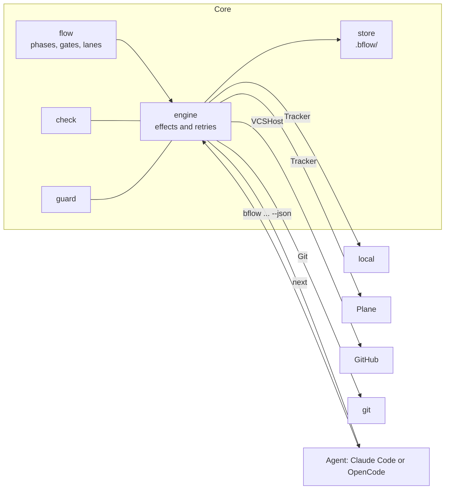
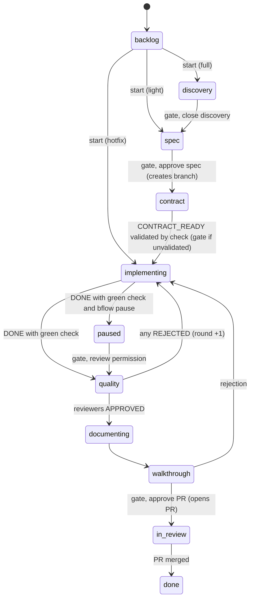

> 🌐 **Language / Idioma:** [Español](../es/conceptos.md) · **English**

# Concepts

bflow separates what **requires judgment** (understanding the problem, designing, coding, reviewing), handled by the agent, from what is **deterministic** (state, transitions, git, tracker, tests, rules), handled by the CLI. The background and rationale are in [why-and-roadmap.md](why-and-roadmap.md); daily workflow is in the [guide](guide.md).

## What it does

- **State machine with human gates.** Each task travels through phases; at decision points (approving spec, answering product questions, approving PR…) the flow stops until a person decides.
- **Lanes.** A standard feature (`full`), a minor change (`light`), or an already merged bug (`hotfix`) travel through different phases. None bypass quality review.
- **`next`: a single instruction for the agent.** Every command responds with what to ask (with exact options and commands for each), what agents to spawn (with arguments and reporting requirements), what to wait for, or whether nothing is pending.
- **Tracker and git without relying on the model.** Updates task state in tracker, stamps start date, posts rejection comments, creates branch when spec is approved, opens PR with review-map and walkthrough, and closes task when PR is merged.
- **Deterministic quality gate (`bflow check`).** Runs project check steps (lint, tests, build, vulnerabilities, secrets), summarizes failures concisely, and binds results to a commit. The agent cannot report "done" without a green check on current code.
- **Rules enforced by code (`bflow guard`).** A hook blocks prohibited actions before they happen: `git reset --hard`, force pushes (`--force`, `-f`, or `+` refspec) or pushes to protected branches, editing `.env` or `.bflow/`, modifying frozen contract tests (including from Bash: `sed -i`, redirects, `tee`, interpreters), subagents approving, rejecting, unblocking, or starting tasks (human decisions only), and creating branches or PRs manually during an active task (handled by bflow). Without blocking, after running native stack tests (`go test`, `npm test`...) it suggests `bflow check --quick <package>` once per session if `check.quick` is defined. Frozen tests are also validated without hooks: `report DONE` and `check --verify` compare contents against the contract, and only a human can accept updates via `bflow freeze`.
- **Metrics.** Time per phase broken down into agent work, human wait, and blocked time; iterations (gate rejections, rounds, decisions); hotfixes linked to the feature they fix (`start --fixes`); friction (rejected requests and `guard` blocks), and tokens per phase, agent, and model parsed from transcripts, separating new tokens from cache hits. How tokens are distributed across tasks: [guide](guide.md#measuring).
- **Output designed for low token consumption.** Compact JSON without redundant fields. A typical response is ~480 bytes, and a failed check returns only failure lines to the agent without duplication; full details are saved to a file.

## Neutral core and adapters

The core only understands internal concepts: task, phase, gate, lane, verdict, and Markdown comment. Everything external is an adapter translating to/from external systems. An architecture test fails if any core package imports an adapter.



| Area | Today | Planned |
|---|---|---|
| Tracker | `local` (files in repo, no account needed), Plane, GitHub Issues and Projects | Jira, Linear, Notion |
| Repository and PR | GitHub (without token, leaves compare URL and PR description ready) | GitLab, Gitea |
| Agent | Claude Code and OpenCode (agents, `/bflow` command, and plugin with guard and tokens) | Codex |
| Stack | Go, Angular, Node (check defaults and code paths) | others |

## Phases and lanes



`paused` is not in any lane by default: a human requests it via `bflow pause <ID>` (before quality) or a lane in `bflow.yaml` declares it. Transitions marked "gate" are human approvals. Any phase can transition to `blocked` and return to where it was. If quality review rejects two consecutive rounds, `bflow` prompts whether to split the feature, return to spec, or perform another round. Tasks are never marked `done` manually: they close upon merge detection. A task can also transition to `dropped` (abandoned without completion) from any working phase via `bflow drop`, or automatically when approving a split creating child tasks.

| Lane | Phases |
|---|---|
| `full` | discovery, spec, contract, implementing, quality, documenting, walkthrough, in_review, done |
| `light` | spec, implementing, quality, documenting, walkthrough, in_review, done |
| `hotfix` | implementing, quality, documenting, walkthrough, in_review, done |

**Hotfixes and reproduction test.** In `hotfix`, implementer's `report DONE` requires a test-only commit (prior to the fix, not the latest commit) whose `bflow check` failed at `check.test_step` (defaults to `test`). The workflow consists of two runs: commit with test and `bflow check` (red); commits with fix and `bflow check` (green). Without that commit, DONE fails with `repro_test_missing`. If testing is genuinely impossible (docs, config, timing race conditions), `report DONE --no-repro "<reason>"` opens the `repro` gate for human decision: accept without test (reason recorded in `decisions.md`, tracker, and `bflow stats`) or request test.

## Gates

A gate is a checkpoint where the flow pauses until a human decides. What is displayed and decided at each gate is detailed in the [guide](guide.md#gates-what-you-see-and-decide).

| Lane | Fixed gates | Conditional gates |
|---|---|---|
| `full` | 5: lane, discovery, spec, product questions, and walkthrough | decision, rounds, `contract`, `pause`, `budget` |
| `light` | 4: lane, spec, product questions, and walkthrough | decision, rounds, `pause`, `budget` |
| `hotfix` | 3: lane, product questions, and walkthrough | decision, rounds, `pause`, `budget`, `repro` |

The lane gate is skipped if the task is created or started with `--lane`. Conditional gates:

- **decision:** an agent returned `NEEDS_DECISION`.
- **rounds:** quality review rejected twice in a row (defaults to 2; configured by `max_quality_rounds`).
- **`contract` (full only):** bflow could not validate the contract automatically. Occurs if no checker exists, if `check.steps` omits `check.test_step`, if the test step fails with `[build failed]` or `[setup failed]`, or if freezing tests fails.
- **`pause`:** only if a human ran `bflow pause <ID>` (or if a lane in `bflow.yaml` declares the `paused` phase). Pauses the task before quality review.
- **`budget`:** only if `flow.budget` is configured and a phase exceeds it.
- **`repro` (hotfix only):** only if implementer reports `DONE --no-repro "<reason>"`.

### T1 Contract: test-first by contract

In `full`, T1 writes acceptance tests and stubs (interfaces and signatures) before production code. Upon reporting `CONTRACT_READY`, bflow requires the contract to be committed and a valid `bflow check` run where those tests fail, then freezes them. If unmet, it rejects with `contract_stale` (missing commit or check), `contract_broken` (failure prior to tests), `contract_green` (T1 tests do not fail), or `contract_hollow` (empty or always-skipped tests). Subsequently, only a human can approve changes to those tests via `bflow freeze`. This represents an acceptance contract locked before implementation, rather than unit test-driven cycles per function.

In `hotfix`, `report DONE` requires a test-only commit prior to the final commit that failed `check.test_step`, or `--no-repro` with the `repro` gate.

## The agent contract: `next`

Every command accepts `--json` and returns the same envelope format. Exit codes are `0` on success, `1` on error, and `2` on flow rejection (e.g., approving an unpending gate).

```json
{"ok":true,"code":"advanced","data":{"id":"API-12","phase":"spec"},
 "next":{"action":"ask","gate":"spec","skill":"approve",
   "show":["bflow show API-12 brief"],
   "question":"Do you approve the spec?",
   "options":[
     {"id":"approve","label":"Approve","command":"bflow approve API-12 --gate spec"},
     {"id":"changes","label":"Request specific changes","needs_note":true,
      "command":"bflow reject API-12 --gate spec --note \"<reason>\""}]}}
```

The main agent session simply interprets `next`:

- `ask`: displays items in `show`, asks human, and executes command for chosen option.
- `spawn`: launches subagents with specified arguments. Each reports back with `bflow report`.
- `wait`: explains what is being awaited.
- `done`: nothing is pending.

When a gate advances the phase, `next` sets `clear: true` and the skill suggests `/clear`: the start hook restores state so context is never lost, as it lives in bflow rather than the chat transcript.

Subagents never query humans directly: they report their verdict and `bflow` decides next actions.

## What remains in repo and what does not

- **In the repo:** only `specs/<ID>-<slug>/spec.md`, with fixed section headers (brief, discovery, requirements, design, tasks, and ui-blueprint if UI stack). The `## Discovery` section contains the full discovery: bflow writes it upon closing the discovery gate; standalone `discovery.md` files in `.bflow/tasks/<ID>/` are no longer generated. `bflow show <ID> spec --section design` parses sections so agents only read what is relevant.
- **In the PR description:** review-map, walkthrough, in-flight decisions, and the contract for consuming teams.
- **In the tracker:** full discovery copy (for reading outside the repo), rejections, and reminders for gates waiting over 24 hours.
- **In `.bflow/`,** automatically gitignored: task state, `log.jsonl`, contract, reports, and check results.

## What it guarantees (and what it does not)

Enforcement inside the CLI holds true across any agent tool. Features relying on hooks apply only where hooks exist.

| Guarantee | Claude Code with bflow hooks | OpenCode with bflow plugin | Without hooks (other tools) |
|---|---|---|---|
| State, phases, and gates managed by bflow, not the model | Yes | Yes | Yes |
| `DONE` requires green check on current commit | Yes | Yes | Yes |
| Contract tests do not change after approval | Yes, edits blocked and verified on report | Yes, edits blocked and verified on report | Yes, verified on report |
| `git reset --hard`, force push (`--force`, `-f`, or `+` refspec) or push to protected branches, `.env`, `.bflow/` (via Edit/Write and Bash) | Yes, blocked before execution | Yes, blocked before execution (if `bflow` missing from PATH, guard does not trigger and plugin warns) | No |
| Branches and PRs created only by bflow while task is active | Yes | Yes | No |
| An agent ending without reporting continues working (2 nudges, then human decision) | Yes | No: OpenCode lacks subagent termination event; covered by `bflow report`, `bflow check --verify`, and AGENTS.md block | No |
| Reviewer inspected files of red diff bullets (decisions) prior to approval (otherwise `review_incomplete`) | Yes, measures reviewer `Read` and Bash in quality | Yes, plugin reports `read` only for `bflow-reviewer` subsession | Not measured or required |
| Tokens per phase, agent, and model | Yes | Yes | No (times only) |

**What bflow does not guarantee:**

- **Code quality.** Inspected by quality agents and by you during walkthrough; bflow guarantees those steps happen, not that they are flawless.
- **Agent craft compliance.** How an agent codes or reviews is defined in prose; bflow enforces the contract (reporting, touched files, conditions for DONE), not style.
- **Bash writes outside `guard` patterns.** In Bash it covers git global options (`-c`, `-C`, `--git-dir`, `--work-tree`), redirects (`>`, `>>`), `tee`, `rm`, `mv`, and `cp` targeting `.env*` or `.bflow/`. It does not cover `eval`, `base64 | sh`, interpreters (`python -c`, `node -e`), or path variables; in those cases `.env` and `.bflow/` are not protected.
- **Containment against malicious agents.** `guard` is a guardrail against common mistakes, not a security sandbox: it verifies known commands and paths, and obscure commands may bypass it.

Next: [configuration](configuration.md) · [commands](commands.md).
